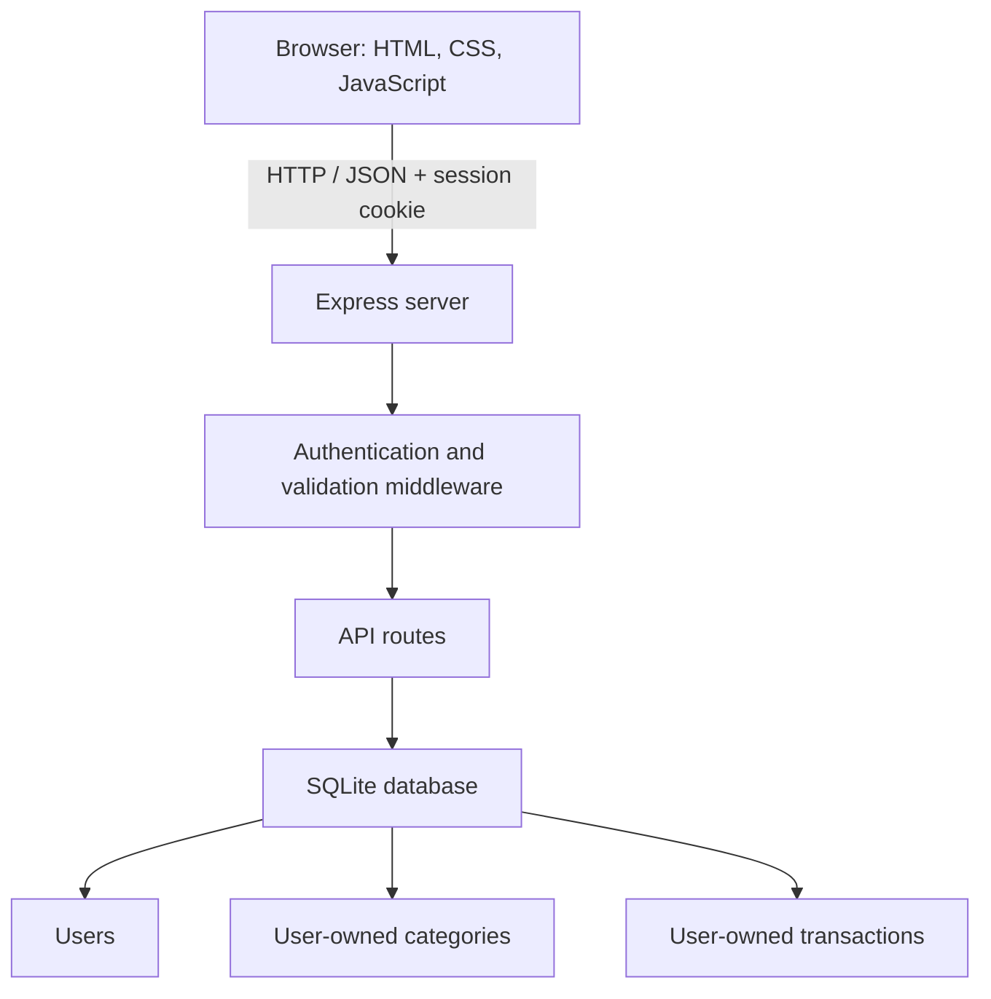

# PocketTrack — Personal Expense Tracker

PocketTrack is a full-stack, multi-user expense tracker built with **Node.js, Express, SQLite, and vanilla JavaScript**. It helps users record income and expenses, review monthly cash flow, and keep each account's financial records private from other accounts.

> **Project status:** Working local application. The app has been manually tested during development. It is a learning and portfolio project, not an audited financial product. Public deployment is not configured.

## Features

- **Account registration and login** with bcrypt password hashing.
- **Private user data:** each account can access only its own transactions and categories.
- **Income and expense tracking** with descriptions, amounts, dates, and categories.
- **Transaction management:** add, edit, delete, search, and filter transactions.
- **Monthly dashboard:** monthly income, expenses, savings rate, category breakdown, and cash-flow chart.
- **All-time balance** alongside month-specific summaries.
- **Input validation** for amounts, descriptions, categories, and transaction dates. Future dates are rejected using India Standard Time.
- **Responsive interface** for desktop, tablet, and mobile screens.

## Technology

| Layer | Technology |
|---|---|
| Frontend | HTML, CSS, vanilla JavaScript |
| Backend | Node.js, Express |
| Database | SQLite with better-sqlite3 |
| Authentication | bcryptjs, JSON Web Tokens, HttpOnly cookies |
| Security middleware | Helmet, express-rate-limit, cookie-parser |
| Configuration | dotenv |

## Application architecture



The server verifies the session cookie and derives the user ID from the verified token. Transaction and category queries are scoped to that authenticated user; the browser does not choose the owner ID.

## Run locally

### Requirements

- Node.js 20 or newer
- npm
- Git (optional, for cloning the repository)

### Setup

1. Clone the repository and enter the project directory:

   ```bash
   git clone https://github.com/gigantic009/pockettrack-expense-tracker.git
   cd pockettrack-expense-tracker
   ```

2. Install dependencies:

   ```bash
   npm install
   ```

   If your npm installation blocks the native build script for `better-sqlite3`, review and approve that package's install script, then rebuild it:

   ```bash
   npm install-scripts approve better-sqlite3
   npm rebuild better-sqlite3
   ```

3. Create your local environment file:

   **Windows CMD**
   ```cmd
   copy .env.example .env
   ```

   **macOS / Linux**
   ```bash
   cp .env.example .env
   ```

4. Edit `.env` and set a private, randomly generated `JWT_SECRET` of at least 32 characters. Keep this value secret and do not commit `.env`.

5. Start the server:

   ```bash
   npm start
   ```

6. Open [http://localhost:3000](http://localhost:3000).

Run the automated validation tests and syntax checks:

```bash
npm test
npm run check
```

The test suite uses Node.js's built-in test runner and covers date, amount, description, and transaction-type validation. It does not replace full API integration or browser end-to-end tests.

For development with Node's watch mode:

```bash
npm run dev
```

The application creates the `data` directory and SQLite database automatically on first run. The database is local to the server.

## Environment variables

| Variable | Purpose | Example |
|---|---|---|
| `PORT` | Local server port | `3000` |
| `JWT_SECRET` | Secret used to sign session tokens; use a private random value of 32+ characters | Set privately in `.env` |
| `NODE_ENV` | Runtime environment; production enables the cookie's Secure flag | `development` |

See [`.env.example`](.env.example) for the variable names and safe placeholders. Never put real secrets in source control.

## API overview

All protected routes require a valid login session.

| Method | Endpoint | Purpose |
|---|---|---|
| POST | `/api/auth/register` | Create an account |
| POST | `/api/auth/login` | Sign in |
| POST | `/api/auth/logout` | Sign out |
| GET | `/api/auth/me` | Get the current account |
| GET | `/api/categories` | List the current user's categories |
| GET | `/api/transactions` | List transactions; optional `month=YYYY-MM` |
| POST | `/api/transactions` | Create a transaction |
| PUT | `/api/transactions/:id` | Update a transaction |
| DELETE | `/api/transactions/:id` | Delete a transaction |
| GET | `/api/summary?month=YYYY-MM` | Get dashboard totals for a month |

## Database

The schema is maintained in [`database/schema.sql`](database/schema.sql).

- `users` stores account details and password hashes.
- `categories` stores categories owned by individual users.
- `transactions` stores income and expense entries owned by individual users.

SQLite data is stored at `data/pockettrack.sqlite`. The `data/` directory is intentionally excluded from Git so personal financial records are not committed.

## Testing and verification

The following checks were performed during local development:

- Account registration and login, duplicate-email rejection, and incorrect-password rejection.
- Isolation between two user accounts.
- Transaction creation, editing, deletion, and balance recalculation.
- Validation of required descriptions, positive amounts, and valid/non-future dates.
- Search and month, category, and transaction-type filtering.
- Dashboard summaries and cash-flow chart values.
- Protected API behavior when unauthenticated.
- Basic local response-time and concurrent-request checks.
- Responsive layout checks at mobile, tablet, and desktop widths.

These are development checks, not a formal automated test suite or independent security audit.

## Security notes and limitations

PocketTrack includes several baseline safeguards:

- Passwords are hashed with bcrypt.
- Session tokens are signed and stored in HttpOnly, SameSite cookies.
- The session cookie uses the Secure flag when `NODE_ENV=production`.
- Login and registration routes are rate-limited.
- Database operations use parameterized queries and user-scoped ownership checks.
- Helmet supplies common HTTP security headers.

**Before exposing the application publicly**, review the full deployment security model. In particular, configure HTTPS and a private production secret, reliable database backups, a suitable CSRF strategy, account recovery, monitoring, and security testing. The current app does not include a formal CSRF-token flow, and its JWT sessions are not centrally revocable before expiry. Content Security Policy is currently disabled in the Helmet configuration. Do not use this project as a production financial service without further engineering and review.

SQLite is convenient for local development and a small single-server deployment with persistent disk storage. A hosted environment must provide persistent storage and a tested backup/restore process; for a larger multi-instance deployment, consider a server database such as PostgreSQL.

## Repository structure

```text
.
├── database/
│   └── schema.sql
├── public/
│   └── index.html
├── data/                 # Local database; ignored by Git
├── .env                  # Local secrets; ignored by Git
├── .env.example
├── .gitignore
├── package.json
├── package-lock.json
├── server.js
└── README.md
```

## License

No license has been added yet. Unless a license is added, the repository should be treated as having no explicit open-source reuse permission.
